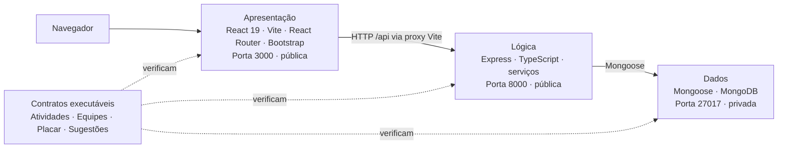

# Arquitetura do OctoFit Tracker

O OctoFit Tracker é uma aplicação de três camadas para um programa de atividades físicas escolar. O código inicial inclui contratos de API e pontos de implementação intencionalmente incompletos para que você use o modo agent do GitHub Copilot em um ciclo guiado por testes.

## Limites entre as camadas

- **Camada de apresentação**: React 19, Vite, React Router, Bootstrap e um cliente compartilhado da API em `octofit-tracker/frontend/src`.
- **Camada de lógica**: rotas e serviços Express com TypeScript em `octofit-tracker/backend/src` expõem o comportamento `/api/*` na porta `8000`.
- **Camada de dados**: modelos Mongoose e dados de demonstração em `octofit-tracker/backend/src/models` e `src/scripts/seed.ts` são persistidos no MongoDB na porta `27017`.

## Portas e regras de ambiente

- MongoDB: `27017` (privada)
- API Express: `8000` (pública)
- Interface Vite: `3000` (pública)
- O navegador acessa caminhos relativos `/api`. O Vite os encaminha para `http://localhost:8000`; `VITE_API_BASE_URL` pode substituir a URL-base.
- Não encaminhe nem torne públicas outras portas.

## Contrato da API

| Capacidade | Método e caminho | Comportamento esperado |
| --- | --- | --- |
| Registro de atividades | `GET /api/activities`, `POST /api/activities` | Lista e cria atividades válidas. POST recebe `userId`, `teamId`, `type` e `minutes`; `userId` e `teamId` devem ser IDs bem-formados de uma pessoa e uma equipe existentes, caso contrário a API retorna um 4xx intencional (nunca um 500 causado por erro de conversão). Uma atividade criada armazena `user`, `team`, `type` e `minutes` enviados, além de `points` e `occurredAt` calculados. |
| Equipes | `GET /api/teams`, `POST /api/teams` | Lista e cria equipes com integrantes. As equipes criadas e listadas mantêm os valores enviados em `name` e `mascot`. Rejeita uma equipe sem nome com `400`. |
| Placar | `GET /api/leaderboard` | Retorna as equipes ordenadas pela soma dos pontos de suas atividades, da maior para a menor. Cada item contém `teamName`, `totalPoints` e uma `rank` iniciada em 1. |
| Sugestões de treino | `GET /api/workouts/suggestions/:userEmail` | Recomenda treinos com base nos padrões de atividade recentes da pessoa correspondente ao e-mail seed. O foco da primeira sugestão (`focus`) corresponde à meta ou à atividade recente dessa pessoa, e o campo `reason` explica o motivo. Um e-mail sem pessoa correspondente retorna um 4xx intencional (por exemplo, `404`). |

## Decisões de implementação

Registre seu plano aqui antes de editar o código.

- **Decisão da camada de apresentação:** os componentes de atividades, equipes, placar e treinos passam a consumir a API pelo cliente compartilhado em `octofit-tracker/frontend/src/api`, usando caminhos relativos `/api`. Cada tela trata carregamento, estado vazio e erro, com alerta acessível. A tela só é implementada depois que o contrato da API estiver verde.
- **Decisão da camada de lógica:** as regras de negócio ficam em `octofit-tracker/backend/src/services/octofitService.ts`, e as rotas em `src/routes/api.ts` apenas recebem a requisição, delegam ao serviço e repassam erros ao middleware. Erros do cliente usam status 4xx com `status` explícito.
- **Decisão da camada de dados:** os modelos Mongoose em `octofit-tracker/backend/src/models` declaram os campos obrigatórios com `required`. O seed em `src/scripts/seed.ts` usa esses modelos, sem scripts diretos do MongoDB, e é idempotente.
- **Abordagem para registro de atividades:** `POST /api/activities` valida `userId` e `teamId` com `isValidObjectId`, confirma que a pessoa e a equipe existem e responde 4xx quando não existem. `points` e `occurredAt` são calculados pelo serviço, e não aceitos do cliente. `user`, `team`, `type` e `minutes` são gravados como enviados.
- **Abordagem para gerenciamento de equipes:** `POST /api/teams` rejeita nome ausente com `400` e mantém `name` e `mascot` como enviados. `GET /api/teams` lista as equipes com seus integrantes.
- **Abordagem para o placar:** `GET /api/leaderboard` agrega os pontos das atividades por equipe, ordena do maior para o menor total e devolve `teamName`, `totalPoints` e `rank` iniciando em 1. A agregação fica no banco, para não carregar todas as atividades na memória.
- **Abordagem para sugestões de treino:** `GET /api/workouts/suggestions/:userEmail` busca a pessoa pelo e-mail, responde `404` quando não existe e monta `focus` a partir da meta ou da atividade recente. `reason` explica a escolha.

## Plano de testes

Registre os comandos executados e o significado de cada falha.

Comandos (executar a partir da raiz do repositório):

- Testes da camada de dados: `npm run test:data --prefix octofit-tracker/backend`
- Testes da API: `npm run test:api --prefix octofit-tracker/backend`
- Testes do frontend: `npm test --prefix octofit-tracker/frontend`
- Compilação do backend: `npm run build --prefix octofit-tracker/backend`
- Compilação do frontend: `npm run build --prefix octofit-tracker/frontend`

Ordem de execução: dados, depois API, depois frontend. Cada etapa só avança quando a anterior estiver verde.

Estado inicial registrado (antes da implementação):

| Suíte | Falhas | Significado |
| --- | --- | --- |
| Dados (`data.contract.test.ts`) | 4 | Os modelos não declaram `required`, então `validateSync()` não aponta campos ausentes. |
| API (`api.contract.test.ts`) | 4 | `createActivity` e `createTeam` lançam `501`, o placar retorna `[]` e as sugestões ignoram o e-mail. |
| Frontend (`app.contract.test.tsx`) | 15 | Os componentes são cartões estáticos: não consomem a API, não exibem dados, não anunciam carregamento, vazio ou erro. |

Ao registrar uma nova execução, anote o comando, o número de falhas e a causa de cada uma.
